# townwalk

Walk a cartoon version of a real town in the browser, streamed from open data on [source.coop](https://source.coop)
with HTTP range requests: only the tiles near the walker are fetched. Starting with Nelson, BC; any town by
`?lat=…&lon=…`.

**Play:** https://alukach.com/raea-townwalk/ · another town: `?lat=51.1784&lon=-115.5708` (Banff)

## Run locally

```sh
python3 -m http.server 8765   # then open http://localhost:8765/
node --test                   # geo math tests
```

No build step: `index.html` loads three.js, pmtiles, vector-tile and pbf from jsDelivr through an import map.
`?aerial=600` puts the camera 600 m up (debugging).

## Data (all range-read from source.coop, nothing pre-downloaded)

| Layer | Source | Tiles |
|---|---|---|
| Buildings, roads, water, land use | Protomaps OSM basemap v4, `protomaps/openstreetmap/v4.pmtiles` | z15 MVT, ~16 KB, kept within 700 m |
| Elevation | NASADEM terrain-RGB, `smartmaps/gel/gel.pmtiles` | z12 WebP, ~80 KB, kept within 1.5 km |

Why not Overture GeoParquet: the `fused/overture` row groups span ~6° of longitude, so the smallest range read
for one town is megabytes. Overture can come back if a finer-partitioned copy shows up.

Range reads use `cache: "no-store"`: Chrome's HTTP cache locks per URL, so parallel ranges of one `.pmtiles`
file queue behind each other ("Stalled" in devtools). Decoded tiles are cached in memory instead.

## Steps

Each step is a commit you can check out.

- [x] **0. Walker** (raea, desktop). Capsule, chase camera, WASD.
- [x] **1. Real buildings** (raea). Overture footprints, extruded, with collision.
- [x] **2. Browser + terrain + streaming.** three.js; buildings and elevation streamed by range request around the
  walker; buildings seated on the slope; walker follows the ground; camera pulls in past walls.
  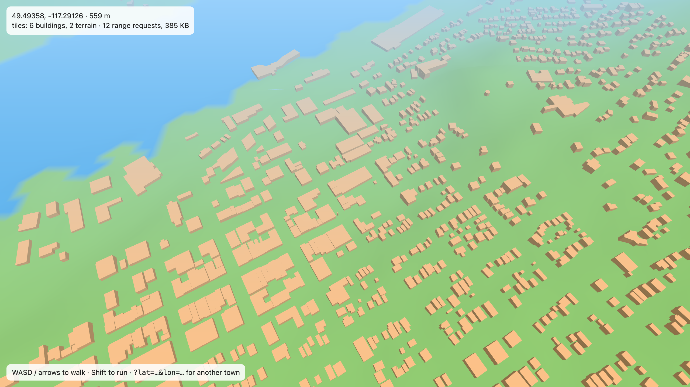 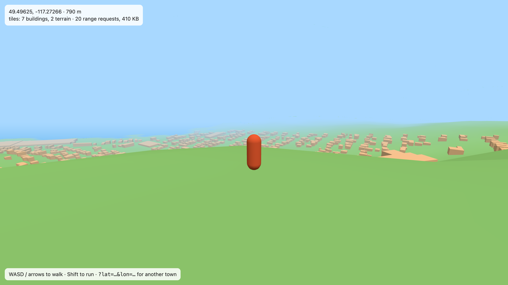
- [x] **3. Maps, streets, water, land use.**
  - GTA-style minimap (turns with you) and full map (**M**): drag, scroll, **double-click to jump**. Far jumps
    reload around the new spot.
  - Roads, water and land use painted per z15 tile (`paint.js`, one style for ground and maps) onto a patch of
    the terrain, so they follow the slope; lakes flattened to their lowest point; water blocks walking.
  - Bridges are raised decks between their ends, walkable (and you can walk under them).
  - Buildings like MapLibre's `fill-extrusion`: `min_height` to `height`, coloured lightgray → royalblue → lightblue
    by height. On slopes, walls reach down to the lowest corner.
  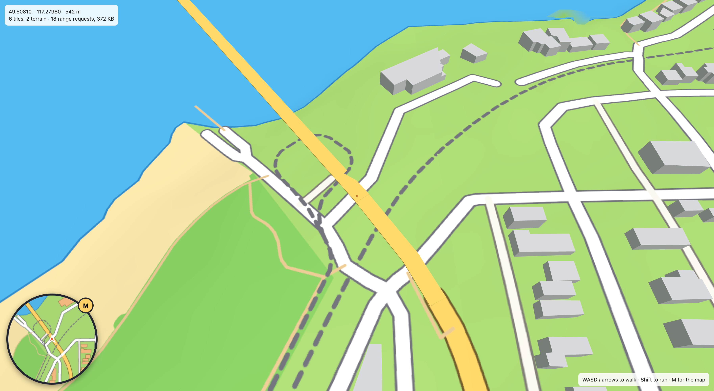 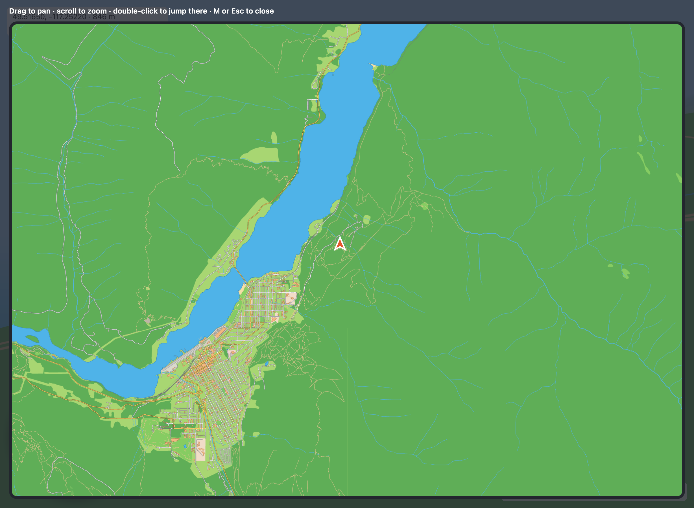
- [x] **4. Cartoon look.**
  - Toon shading (three flat bands) everywhere; ink lines on building edges; an outlined walker.
  - Pitched (hipped) roofs on small, low buildings, from a bevel that insets the top cap; any footprint works.
    Pastel walls drift into MapLibre's height ramp as buildings get taller.
  - Roads are draped ribbons (casing + fill, round joins) on the ground's own surface, so they stay sharp at
    street level; the ground texture keeps land use and water.
  - Instanced pines on a jittered grid, kept where a small road-aware paint of the tile says wood or park.
  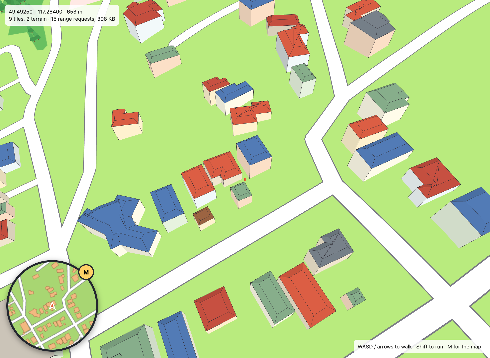 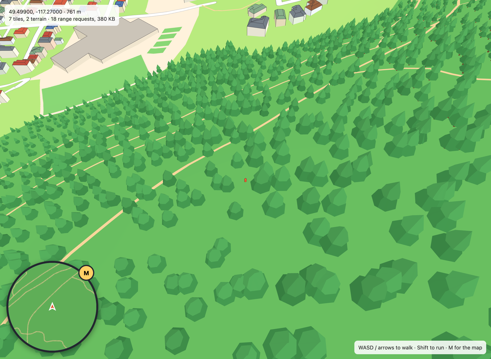 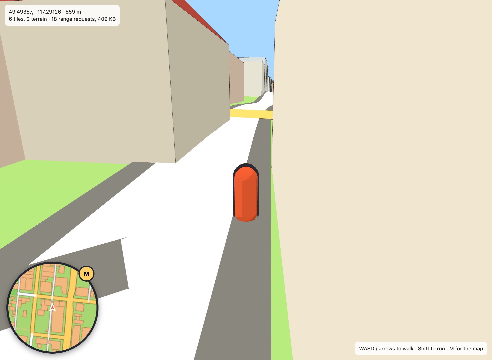
- [x] **5. Shadows, phones, solid trees.**
  - Hard-edged sun shadows (cel look) in a box that follows the walker; faces turned from the sun use the same
    tone as cast shadows.
  - Phones/tablets (`pointer: coarse`, or `?mobile`): a virtual stick (push to the rim to run), pinch-zoom and
    double-tap on the full map, smaller panels, and a lighter profile (pixel ratio 1.5, 1024 px ground, 1024 shadow
    map, 450 m of tiles, fewer trees).
  - Trees block walking (trunks; the boughs stay walk-through) and pull the camera in; woods 1.5x denser.
  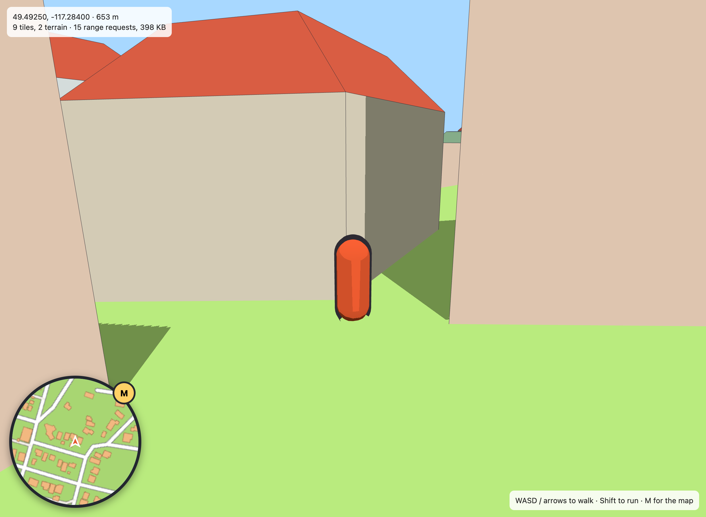 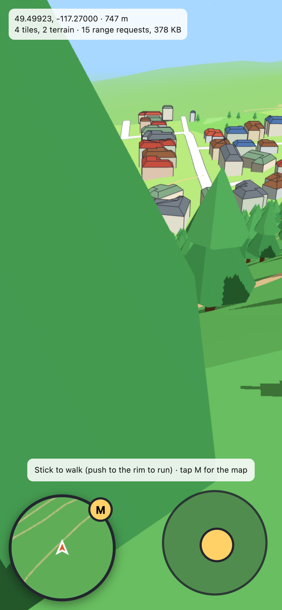
- [x] **6. Any town, and OSM-driven detail.**
  - Place search (top): [Photon](https://photon.komoot.io) (OSM geocoder; only what you type is sent) or `lat, lon`.
    Far jumps, and walking >4 km from the origin, re-centre the world in place (no reload); the URL follows you.
  - Roads are drawn by the ground: each tile bakes a road distance field on the GPU (`roads.js`), and the ground
    shader paints asphalt, kerbs, sidewalks, centre dashes and rails from it. Exact draping, sharp up close.
    **`ROAD_STYLE` is the table that says how each OSM road kind looks** (widths, sidewalks, markings).
  - Buildings styled by what's in/under them: shops (POI or commercial land) get shop windows + awnings, churches a
    steeple, schools/hospitals brick, civic buildings stone, industry metal; tall buildings get window bands.
  - Street furniture from OSM points (lamps, benches, picnic tables, signals, stop signs, bins, bike racks, post
    boxes, fountains), solid like trunks. Named POIs float as labels (icon + name) over their roof.
  - Current street and area, GTA-style, top right; a title card when you enter a new area. Street names and POI
    icons on the maps. Terrain tiles have skirts so seams don't show sky. Soft shadows.
  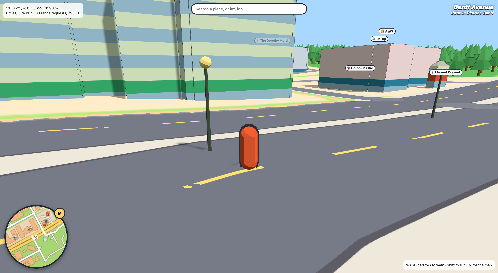 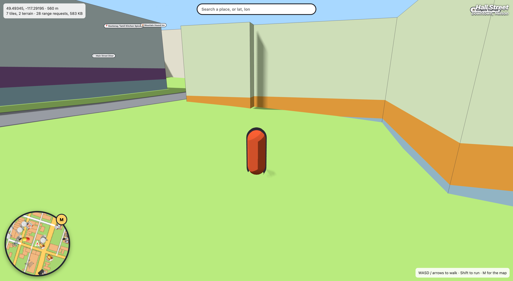 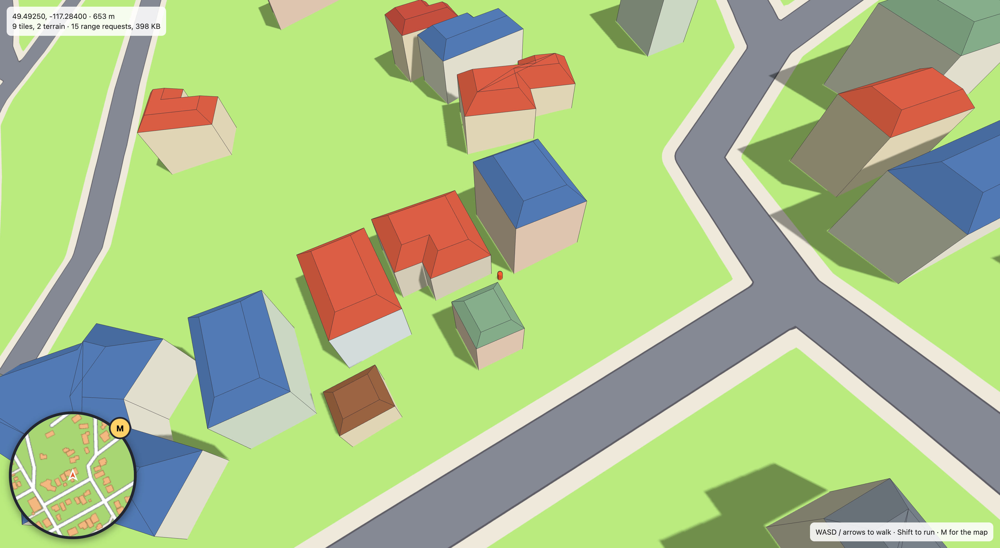 Place search, re-origin when far from start, terrain seams, loading by view direction.
