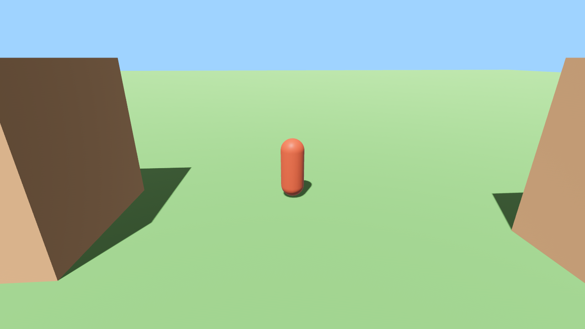
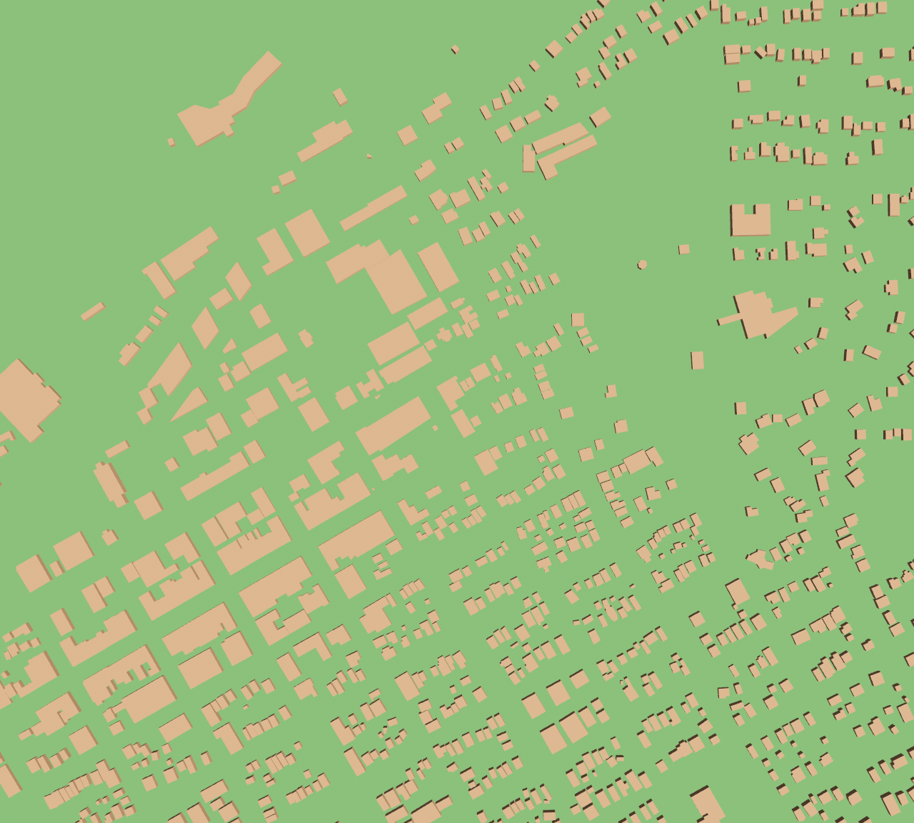
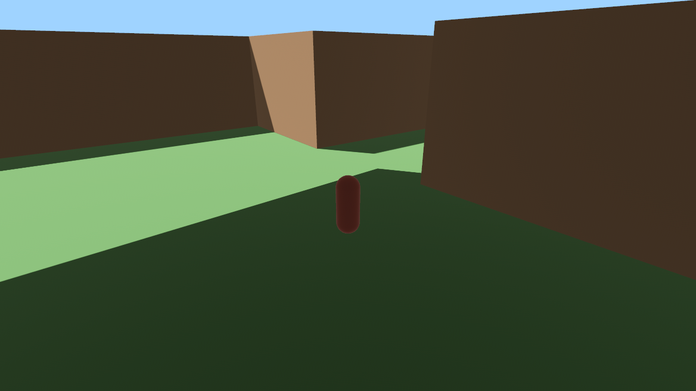

# raea-townwalk

Walk a cartoon version of a real town, built from open data on [source.coop](https://source.coop) and rendered with
[raea](https://raea.io). Starting with Nelson, BC; the goal is any town on the globe, loaded on the fly.

## Run

```sh
uv run fetch_town.py nelson -117.300 49.488 -117.280 49.500   # -> media/nelson.json (bbox: W S E N)
raea play walk.tsx                                            # WASD / arrows to walk
raea render walk.tsx --at 0,150,299 -o out/frames/            # stills (keyless renders use an autopilot)
raea render walk.tsx --composition overview --at 0 -o out/overview/   # top-down debug view
```

## Data

| Layer | Source | Used from |
|---|---|---|
| Buildings | Overture Maps (`fused/overture`, release 2026-04-15-0) | step 1 |
| Elevation | NASADEM RGB tiles, PMTiles (`smartmaps/gel`) | step 2 (planned) |
| Roads, water, land use | Overture `transportation` / `base` | step 3 (planned) |

## Steps

Each step is a commit you can check out and run.

- [x] **0. Walker.** A capsule on flat ground, chase camera, WASD. 
- [x] **1. Real buildings.** Overture footprints for downtown Nelson, extruded to height (6 m when unknown), as one
  composed mesh; point-in-polygon collision with wall sliding.
   
- [ ] **2. Terrain.** Nelson sits on a steep slope above the West Arm: a heightfield from NASADEM. Buildings and
  the walker sit on it.
- [ ] **3. Streets and water.** Road ribbons by class, Kootenay Lake, parks.
- [ ] **4. Cartoon look.** Toon shading and outlines, roof shapes, trees, colour by building class.
- [ ] **5. Any town.** Fetch by place name or the current view, stream tiles in as you walk.
